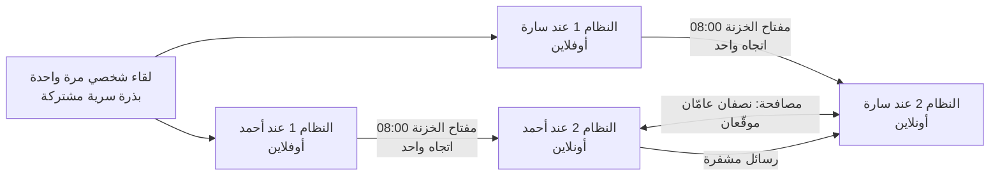

<div dir="rtl">

# تشفير بمفاتيح تتغيّر آليًا وبشكل متزامن (نموذج أولي)

## الفكرة الأصلية

عند إرسال رسالة مشفرة، إذا استطاع مخترق تتبّع الرسائل والوصول إلى طريقة فك تشفيرها، فإنه يقرأ كل شيء.
الفكرة: نضيف **نظامًا أوفلاين مستقلًا (رقم 1)** إلى جانب **النظام الأونلاين (رقم 2)**.
في وقت محدد (مثلًا الساعة 8 صباحًا) يتصل النظام 1 بالنظام 2 لحظة واحدة **ليغيّر التشفير بطريقة عشوائية**، ثم ينفصل.
يحدث الشيء نفسه عند المرسل وعند المستقبل في الوقت نفسه، فيبقيان متزامنين دون أن يتمكن أحد من تتبّع التغيير.

## هل الفكرة صحيحة؟

**نعم، والاتجاه صحيح.** هذا النوع من الحلول مستعمل فعلًا في أنظمة حقيقية:

| النظام الحقيقي | ما يشترك فيه مع فكرتك |
|---|---|
| تطبيقات الرموز المؤقتة (Google Authenticator) | سرّ مشترك + الساعة = رمز جديد متطابق عند الطرفين دون أي تواصل |
| المفاتيح الجذرية في البنوك والشركات | المفتاح الأهم محفوظ في جهاز **غير متصل** ولا يُستعمل إلا عند الحاجة |
| تطبيق Signal | المفتاح يتغيّر باستمرار بتبادل Diffie-Hellman، فسرقة مفتاح واحد لا تكشف الرسائل الأخرى |

لكي تصبح الفكرة آمنة فعلًا طُبّقت عليها **أربعة تعديلات**:

### التعديل 1: نغيّر "المفتاح" وليس "المعادلة"

اختراع معادلات تشفير جديدة عشوائيًا يُنتج غالبًا تشفيرًا ضعيفًا يمكن كسره.
الحل المعتمد عالميًا: نستعمل خوارزمية واحدة مجرَّبة ومدروسة جيدًا (**AES-256**) ونغيّر **مفتاحها**.

والمهم هنا: خوارزمية AES مع مفتاح معيّن هي في الحقيقة **دالة تشفير** مختلفة.
عدد المفاتيح الممكنة هو 2<sup>256</sup>، أي رقم من 78 خانة. إذًا عندما نغيّر المفتاح، فنحن فعلًا **نختار عشوائيًا دالة جديدة من بين عدد هائل من الدوال**، وهذه هي فكرتك نفسها، لكن بدوال لم ينجح أحد في كسرها منذ أكثر من 20 سنة.

> قاعدة كيركهوفس (Kerckhoffs): يجب أن يبقى النظام آمنًا حتى لو عرف المخترق كل تفاصيله ما عدا المفتاح.

### التعديل 2: "متزامن" يحتاج إلى بذرة مشتركة

إذا اختار كل طرف رقمًا عشوائيًا بمفرده، فلن يحصلا على الرقم نفسه أبدًا.
الحل: عند **اللقاء الأول (مرة واحدة فقط)** نُنشئ **بذرة سرية عشوائية** ويأخذ كل طرف نسخة منها في جهازه الأوفلاين.
بعد ذلك يحسب كل طرف "مفتاح الخزنة" لكل يوم من البذرة بـ**دالة باتجاه واحد**:

```
بذرة → سلسلة(1) → سلسلة(2) → سلسلة(3) → ...
           ↓          ↓          ↓
   مفتاح خزنة(1)  مفتاح خزنة(2)  مفتاح خزنة(3)
```

- **لمن لا يملك البذرة:** المفاتيح تبدو عشوائية تمامًا، ولا يمكن توقّع مفتاح الغد من مفتاح اليوم.
- **للمرسل والمستقبل:** يحصلان على المفتاح نفسه بالضبط، في الوقت نفسه، **دون أن يتواصلا**.
- **الأسهم تسير في اتجاه واحد فقط:** بعد كل تغيير تُتلف الخزنة حالتها القديمة. لذلك حتى لو سُرقت الخزنة اليوم، لا يستطيع السارق حساب مفاتيح الأيام الماضية.

### التعديل 3: "عشوائي بحت" عن طريق تبادل Diffie-Hellman كل يوم

المشكلة المتبقية في التعديل 2: من يسرق الخزنة يستطيع حساب **مفاتيح المستقبل** كلها، لأن السلسلة محسوبة مسبقًا.
الحل: عند كل تغيير يولّد كل جهاز متصل **سرًا عشوائيًا جديدًا تمامًا** لا يغادره أبدًا، ويتفق الطرفان على سرّ مشترك عبر الإنترنت **دون أن يمر هذا السرّ نفسه عبر الإنترنت**. هذا هو تبادل Diffie-Hellman.

**شرحه بالألوان:**

1. يتفق أحمد وسارة علنًا على لون أساسي، مثلًا الأصفر.
2. يختار كل منهما لونًا سريًا لا يخبر به أحدًا: أحمد الأحمر، وسارة الأزرق.
3. يمزج كل منهما لونه السري بالأصفر ويرسل الخليط **علنًا**. هذا الخليط هو "النصف العام".
4. يضيف كل منهما لونه السري إلى خليط الآخر، فيحصلان على **اللون نفسه**: أصفر + أحمر + أزرق.
5. المخترق يرى الأصفر والخليطين، لكن **فصل الألوان عن خليط مستحيل عمليًا**، فلا يستطيع الوصول إلى اللون النهائي.

في البرنامج "الألوان" أرقام ضخمة على منحنى رياضي (X25519)، وفصلها يحتاج ملايين السنين من الحساب.

**مفتاح اليوم النهائي = مزج (مفتاح الخزنة + سرّ Diffie-Hellman)**

لقراءة رسائل يوم ما يحتاج المخترق إلى **الاثنين معًا**:

| ما يملكه المخترق | هل يقرأ رسائل الأيام التالية؟ |
|---|---|
| تسجيل كل ما مر عبر الإنترنت | ❌ لا |
| الخزنة المسروقة + تسجيل كل الإنترنت | ❌ لا، ابتداءً من أول مصافحة بعد السرقة، لأن السرّ العشوائي الجديد وُلد بعدها ولم يغادر الجهاز |
| القدرة على كسر Diffie-Hellman يومًا ما (حاسوب كمّي مستقبلي مثلًا) | ❌ لا، لأنه لا يملك مفتاح الخزنة |

إذًا الجمع بين الطريقتين أقوى من كل واحدة وحدها.

**ودور الخزنة هنا مزدوج:** كل نصف عام يُرسل **موقّعًا** بمفتاح الخزنة، فإذا حاول مخترق أن يدسّ نصفه هو في المنتصف (انتحال)، يُرفض فورًا لأنه لا يملك مفتاح الخزنة.

### التعديل 4: النقل من النظام 1 إلى النظام 2 في اتجاه واحد فقط

إذا "اتصل" النظام الأوفلاين بالأونلاين في الاتجاهين، فقد ينتقل فيروس من الأونلاين إلى الأوفلاين.
الحل: النظام 1 **يُخرج** مفتاح الخزنة فقط ولا **يستقبل** أي شيء. أما المصافحة فتحدث بين الجهازين المتصلين وحدهما، فتبقى الخزنة معزولة تمامًا.
أفضل طريقة عملية للنقل: تعرض الخزنة رمز QR على شاشتها وتقرؤه كاميرا الهاتف. في هذا النموذج يُحاكى النقل بمجلد (كأنه فلاشة)، ويُمسح المفتاح منه فور استيراده.

## كيف يعمل النظام



1. **مرة واحدة:** لقاء شخصي، وإنشاء البذرة، وكل طرف يضع نسخته في جهازه الأوفلاين.
2. **كل يوم الساعة 08:00 (آليًا):** كل خزنة تحسب مفتاح الخزنة لليوم وحدها، وتُخرجه للنظام المتصل، وتُتلف حالتها القديمة.
3. **المصافحة:** كل نظام متصل يولّد سرًا عشوائيًا جديدًا، ويرسل نصفه العام موقّعًا إلى الطرف الآخر.
4. **عند وصول نصف الطرف الآخر:** يتحقق النظام من التوقيع، ويحسب مفتاح اليوم النهائي، ثم **يُتلف** السرّ العشوائي ومفتاح الخزنة فورًا.
5. **الرسائل** تُشفّر بمفتاح اليوم النهائي (AES-256-GCM)، ويُكتب رقم اليوم في رأس الرسالة ليعرف المستقبل أي مفتاح يستعمل.
6. **النظام المتصل يحتفظ بمفتاحين فقط:** مفتاح اليوم ومفتاح الأمس (حتى لا تضيع رسالة أُرسلت 07:59 ووصلت 08:01)، ويُتلف ما هو أقدم.
7. إذا لم يُستورد مفتاح اليوم أو لم تكتمل المصافحة، **يرفض النظام التشفير** ولا يستمر بمفتاح قديم.

## ماذا يحمي هذا النظام؟ وماذا لا يحمي؟

| السيناريو | النتيجة |
|---|---|
| مخترق يسجّل كل ما يمر عبر الإنترنت | ✅ لا يستطيع قراءة شيء |
| مخترق يدسّ نصفًا عامًا مزيفًا (انتحال في المنتصف) | ✅ يُرفض لأنه غير موقّع بمفتاح الخزنة |
| مخترق يعدّل حرفًا في رسالة | ✅ تُكتشف وتُرفض تلقائيًا |
| اختراق الجهاز المتصل (النظام 2) | ⚠️ يقرأ رسائل اليوم والأمس فقط، ثم يُطرد عند المصافحة التالية |
| سرقة الخزنة الأوفلاين (النظام 1) | ✅ الماضي محمي، و✅ المستقبل محمي من المراقب الصامت. ⚠️ لكن إذا كان يتحكم في الشبكة نفسها، يستطيع توقيع مصافحات مزيفة (انتحال نشط) |
| سرقة الجهازين معًا | ⚠️ نافذة يومين، ثم يُطرد عند المصافحة التالية (إن لم يكن ينتحل بشكل نشط) |
| الطرف الآخر غير متصل صباحًا | ⚠️ لا يمكن الإرسال حتى تصل مصافحته (حدّ في هذا النموذج) |
| فيروس يقرأ الشاشة بعد فك التشفير | ❌ لا يوجد تشفير يحمي من هذا |
| إعادة إرسال رسالة قديمة مسجّلة (Replay) خلال نافذة اليومين | ❌ غير محمي في هذا النموذج |
| ساعة أحد الجهازين خاطئة | ⚠️ يفقد الطرفان التزامن، لذلك يحتاج الجهاز الأوفلاين إلى ساعة دقيقة |

**لكشف الانتحال النشط:** يعرض الأمر `status` "بصمة مفتاح اليوم". إذا قرأها أحمد وسارة لبعضهما بالهاتف وكانت متطابقة، فلا يوجد أحد في المنتصف. وإذا سُرقت خزنة، يجب إعادة الاقتران ببذرة جديدة.

**ملاحظة مهمة:** التشفير الحديث (مثل AES) لا يُكسر بمجرد تتبّع الرسائل. الخطر الحقيقي هو **سرقة المفاتيح**، وهنا تكمن قيمة فكرتك: إبعاد السرّ الأساسي عن الإنترنت، وتغيير المفتاح باستمرار حتى **يُطرد** أي مخترق بسرعة.

## التجربة

تحتاج إلى Python 3.9 أو أحدث:

```bash
cd synced-key-rotation
pip install -r requirements.txt

python demo.py              # محاكاة كاملة على 6 أيام: مرسل، مستقبل، ومخترق
python -m unittest -v       # 28 اختبارًا آليًا
```

### الاستعمال اليدوي بالأوامر

```bash
# 1) مرة واحدة: اللقاء الأول (ينشئ ملفين، واحد لكل طرف)
python offline_vault.py pair --me ahmed_vault.json --peer sara_vault.json --rotation-hour 8

# 2) كل يوم عند موعد التغيير، على الجهاز الأوفلاين:
python offline_vault.py release --vault ahmed_vault.json --out /media/usb

# 3) على الجهاز المتصل: استيراد مفتاح الخزنة. يطبع "مصافحتك" لهذا اليوم:
#    أرسلها إلى الطرف الآخر بأي وسيلة (نشرها آمن)
python online_node.py import --node ahmed_node.json --from /media/usb

# 4) قبول مصافحة الطرف الآخر. بعدها يصبح مفتاح اليوم جاهزًا
python online_node.py accept --node ahmed_node.json "AkgAAAAB..."

# 5) التشفير وفك التشفير
python online_node.py encrypt --node ahmed_node.json "رسالتي السرية"
python online_node.py decrypt --node sara_node.json "Ak0AAAAB..."

# عرض الحالة وبصمة مفتاح اليوم (للمقارنة بالهاتف)
python online_node.py status --node ahmed_node.json
```

**الأتمتة (التغيير الآلي عند الساعة 8):** على جهاز لينكس أوفلاين، أضف هذا السطر بالأمر `crontab -e`:

```
0 8 * * * cd /path/to/synced-key-rotation && python3 offline_vault.py release --vault vault.json --out /media/usb
```

> ساعة التغيير في البرنامج تُحسب بتوقيت **UTC** حتى يتزامن الطرفان ولو كانا في بلدين مختلفين.
> مثال: إذا كان توقيتك UTC+1، فالساعة 08:00 عندك هي 07:00 UTC، فاستعمل `--rotation-hour 7`.

## الملفات

| الملف | الدور |
|---|---|
| `offline_vault.py` | **النظام 1**: الخزنة الأوفلاين (البذرة، والسلسلة، وإخراج مفتاح الخزنة لليوم) |
| `online_node.py` | **النظام 2**: النظام المتصل (المصافحة بـ Diffie-Hellman، والتشفير، وفك التشفير) |
| `common.py` | الجدول الزمني المشترك، والبصمات، والكتابة الآمنة للملفات |
| `demo.py` | محاكاة كاملة للسيناريوهات |
| `test_system.py` | الاختبارات الآلية |

## الخطوات التالية لتحويله إلى نظام حقيقي

1. **مصافحة مسبقة (Prekeys):** يرسل كل طرف نصف الغد مسبقًا، فلا يضطر أحد إلى انتظار الآخر صباحًا. هكذا يفعل Signal.
2. **نقل مفتاح الخزنة برمز QR** بدل الفلاشة، ليصبح النقل في اتجاه واحد فعلًا.
3. **جهاز أوفلاين مخصص:** مثلًا Raspberry Pi بلا Wi-Fi وبلا Bluetooth، مع وحدة ساعة دقيقة (RTC)، أو مفتاح أمان مادي.
4. **منع إعادة الإرسال (Replay):** إضافة عدّاد لكل رسالة.
5. **مراجعة أمنية** من مختصين قبل الاعتماد عليه في أسرار حقيقية.

> ⚠️ **تنبيه:** هذا نموذج تعليمي يجسّد الفكرة ويثبت أنها تعمل. للمراسلات الحساسة الحقيقية اليوم، استعمل تطبيقًا مجرّبًا مثل **Signal**، فهو يطبّق نسخة أكثر تطورًا من الفكرة نفسها: تبادل Diffie-Hellman يحدث مع الرسائل نفسها، وليس مرة في اليوم.

</div>
