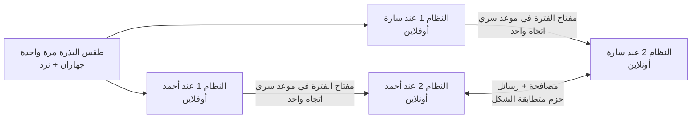

<div dir="rtl">

# تشفير بمفاتيح تتغيّر في مواعيد سرية وبعشوائية حقيقية (نموذج أولي)

## الفكرة الأصلية

عند إرسال رسالة مشفرة، إذا استطاع مخترق تتبّع الرسائل والوصول إلى طريقة فك تشفيرها، فإنه يقرأ كل شيء.
الفكرة: نضيف **نظامًا أوفلاين مستقلًا (رقم 1)** إلى جانب **النظام الأونلاين (رقم 2)**.
في أوقات معينة يتصل النظام 1 بالنظام 2 لحظة واحدة **ليغيّر التشفير بطريقة عشوائية**، ثم ينفصل.
يحدث الشيء نفسه عند المرسل وعند المستقبل في الوقت نفسه، فيبقيان متزامنين دون أن يتمكن أحد من تتبّع التغيير.

## هل الفكرة صحيحة؟

**نعم.** جوهرها مستعمل في أنظمة حقيقية:

| النظام الحقيقي | ما يشترك فيه مع فكرتك |
|---|---|
| تطبيقات الرموز المؤقتة (Google Authenticator) | سرّ مشترك + الساعة = رمز جديد متطابق عند الطرفين دون أي تواصل |
| المفاتيح الجذرية في البنوك والشركات | المفتاح الأهم محفوظ في جهاز **غير متصل** |
| تطبيق Signal | مفتاح جديد لكل رسالة، وعشوائية جديدة باستمرار، فسرقة مفتاح لا تكشف الرسائل الأخرى |

## طبقات الحماية الثمانية

| # | الطبقة | ماذا تفعل |
|---|---|---|
| 1 | **نغيّر المفتاح لا المعادلة** | خوارزميات عالمية مجرَّبة؛ تغيير المفتاح = اختيار دالة جديدة من بين 2<sup>256</sup> دالة |
| 2 | **طقس البذرة** | البذرة المشتركة مزيج من 3 مصادر عشوائية مستقلة: جهازان + رميات نرد |
| 3 | **مواعيد تغيير سرية** | كل تغيير بعد مدة عشوائية (بين ساعتين و10 ساعات، بدقة الثانية) لا يعرفها إلا الطرفان |
| 4 | **عشوائية جديدة عند كل تغيير** | تبادل Diffie-Hellman: المفتاح المسروق يموت عند التغيير التالي، حتى لو سُرقت الخزنة |
| 5 | **مفتاح لكل رسالة** | يُتلف لحظة قراءتها: سرقة الجهاز لا تكشف أي رسالة مقروءة، والرسالة المكررة تُرفض |
| 6 | **طبقتا تشفير** | AES-256 داخل ChaCha20، لكل منهما مفتاحها: يجب كسر الخوارزميتين معًا |
| 7 | **إخفاء الآثار** | كل الحزم بطول ثابت ومشفّرة بالكامل: لا نوع، ولا طول، ولا رقم ظاهر |
| 8 | **النقل في اتجاه واحد** | الخزنة الأوفلاين تُخرج ولا تستقبل شيئًا أبدًا |

## التفاصيل

### 1. نغيّر "المفتاح" وليس "المعادلة"

اختراع معادلات تشفير جديدة يُنتج غالبًا تشفيرًا ضعيفًا. الحل المعتمد عالميًا: خوارزميات مجرَّبة ومدروسة، ونغيّر **مفاتيحها**.
خوارزمية AES مع مفتاح معيّن هي **دالة تشفير** مختلفة، وعدد المفاتيح الممكنة 2<sup>256</sup> (رقم من 78 خانة). إذًا تغيير المفتاح هو فعلًا **اختيار عشوائي لدالة جديدة**، وهذه هي فكرتك نفسها، لكن بدوال لم يكسرها أحد.

> قاعدة كيركهوفس (Kerckhoffs): يجب أن يبقى النظام آمنًا حتى لو عرف المخترق كل تفاصيله ما عدا المفتاح.

### 2. طقس البذرة: عشوائية من ثلاثة مصادر

لكي يحصل الطرفان على المفاتيح نفسها دون تواصل، يحتاجان إلى **بذرة سرية مشتركة** تُصنع مرة واحدة في لقاء شخصي. تُصنع البذرة بمزج:
- عشوائية جهاز الطرف الأول (256 بت)،
- عشوائية جهاز الطرف الثاني (256 بت)،
- **100 رمية نرد حقيقية** (حوالي 258 بت).

المزج يأخذ **قوة أقوى مصدر**: يكفي أن يكون مصدر واحد سليمًا وسريًا. فلو كان مولّد أحد الجهازين معطوبًا، كما حدث فعلًا في خطأ Debian سنة 2008، أنقذه النرد. ولو رأى أحد رميات النرد، أنقذه الجهازان.

وكل رقم عشوائي يمر قبل استعماله بـ**فحص صحة**: إذا أعطى المولّد أصفارًا أو كرر نتيجة سابقة (كما حدث لجهاز PlayStation 3 سنة 2010)، يتوقف البرنامج بدل أن يصنع مفاتيح ضعيفة بصمت.

### 3. مواعيد تغيير سرية وغير منتظمة

لا يوجد "الساعة 8 كل يوم". مدة كل فترة تُحسب من السلسلة السرية نفسها: رقم بين ساعتين و10 ساعات، بدقة الثانية، مثلًا:

```
التغيير 1: 02:25:17   (بعد 6.42 ساعة)
التغيير 2: 05:23:15   (بعد 2.97 ساعة)
التغيير 3: 10:45:04   (بعد 5.36 ساعة)
```

الطرفان يحسبان المواعيد نفسها بالضبط دون أن يتواصلا، أما المخترق فلا يستطيع توقّعها. ويمكن اختيار حدود أخرى عند الاقتران.

### 4. عشوائية جديدة عند كل تغيير (Diffie-Hellman)

لو اكتفينا بالسلسلة المحسوبة من البذرة، لاستطاع من يسرق الخزنة حساب كل المفاتيح القادمة. لذلك عند كل تغيير يولّد كل جهاز متصل **سرًا عشوائيًا جديدًا** لا يغادره أبدًا، ويتفق الطرفان على سرّ مشترك **دون أن يمر هذا السرّ عبر الإنترنت**.

**شرحه بالألوان:** يتفق الطرفان علنًا على لون أصفر. يختار كل منهما لونًا سريًا، ويمزجه بالأصفر، ويرسل الخليط علنًا. ثم يضيف كل منهما لونه السري إلى خليط الآخر، فيحصلان على **اللون نفسه**. المخترق يرى الأصفر والخليطين، لكن **فصل الألوان عن خليط مستحيل عمليًا**.

**مفتاح الفترة = مزج (مفتاح الخزنة + سرّ Diffie-Hellman)**

| ما يملكه المخترق | هل يقرأ الرسائل بعد التغيير التالي؟ |
|---|---|
| تسجيل كل ما مر عبر الإنترنت | ❌ لا |
| الخزنة المسروقة + تسجيل كل الإنترنت | ❌ لا: السرّ العشوائي الجديد وُلد بعد السرقة ولم يغادر الجهاز |
| القدرة على كسر Diffie-Hellman يومًا ما (حاسوب كمّي مثلًا) | ❌ لا: لا يملك مفتاح الخزنة |

والمصافحة نفسها مشفرة بمفاتيح مشتقة من مفتاح الخزنة، فمن لا يملك الخزنة لا يستطيع دسّ نصف مزيف.

### 5. مفتاح جديد لكل رسالة

بعد المصافحة، لكل اتجاه سلسلة رسائل خاصة:

```
سلسلة → سلسلة → سلسلة → ...
  ↓        ↓        ↓
رسالة 0  رسالة 1  رسالة 2
```

- مفتاح كل رسالة **يُتلف لحظة إرسالها أو قراءتها**. من يسرق الهاتف لا يستطيع قراءة أي رسالة سبق إرسالها أو قراءتها.
- إعادة إرسال رسالة مسجّلة (Replay) تُرفض، لأن مفتاحها لم يعد موجودًا.
- الرسائل التي تصل بغير ترتيبها تُقرأ عاديًا.
- **المكشوف الوحيد:** إذا سُرق الجهاز، يقرأ السارق ما يصل بعد السرقة **حتى التغيير التالي فقط**.

انتبه: مفاتيح السلسلة **محسوبة** وليست عشوائية بحد ذاتها، ولهذا تحمي **الماضي**. أما **المستقبل** فتحميه العشوائية الجديدة عند كل تغيير (الطبقة 4).

### 6. طبقتا تشفير بخوارزميتين مختلفتين

```
النص ← AES-256-GCM ← ChaCha20-Poly1305 ← الإنترنت
```

لكل طبقة مفتاحها المستقل، والخوارزميتان معياران عالميان بتصميم رياضي مختلف. **مثال الأقفال:** التبديل بين قفلين يومًا بيوم يجعل الأمان مساويًا لأضعف قفل؛ أما وضع القفلين معًا فيجعل اللص مضطرًا لكسر الاثنين. في المحاكاة نتخيّل أن المخترق كسر ChaCha20 بالكامل، فيجد تحتها نصًا ما زال مشفرًا بـ AES.

هذه الطبقة تحمي من **كسر خوارزمية**، لا من **سرقة المفتاح**، لأن مفتاحَي الطبقتين يأتيان من مفتاح الرسالة نفسه. الحماية من السرقة تقوم بها الطبقات 4 و5.

### 7. إخفاء الآثار

حتى أقوى تشفير لا يخفي وحده **متى** و**كم** يتراسل الطرفان. لذلك:
- كل حزمة **1024 بايت بالضبط**: المصافحة، والرسالة القصيرة، والطويلة (حتى 951 بايت، أي حوالي 475 حرفًا عربيًا).
- **الرأس مشفّر أيضًا**: المراقب لا يرى رقم الفترة، ولا رقم الرسالة، ولا من المرسل، ولا هل الحزمة مصافحة أم رسالة.

### 8. النقل من النظام 1 إلى النظام 2 في اتجاه واحد

النظام 1 **يُخرج** مفتاح الفترة ولا **يستقبل** أي شيء، فلا يستطيع فيروس الانتقال إليه من الجهاز المتصل. المصافحة تحدث بين الجهازين المتصلين وحدهما. أفضل وسيلة عملية للنقل: رمز QR تعرضه شاشة الخزنة وتقرؤه كاميرا الهاتف. في هذا النموذج يُحاكى النقل بمجلد (كأنه فلاشة)، ويُمسح المفتاح منه فور استيراده.

## دراسة العشوائية (`randomness_lab.py`)

هل "يبدو عشوائيًا" يعني "لا يمكن تتبّعه"؟ يأخذ المختبر 3 مولّدات، ويطبّق عليها الاختبارات الإحصائية نفسها، ثم يهاجمها:

| المولّد | الاختبارات الإحصائية | الهجوم |
|---|---|---|
| **سلسلتنا** (HMAC-SHA256) | ✅ نجح | ✅ لا طريق مختصر معروف: التخمين يحتاج 3.7×10<sup>41</sup> سنة بكل حواسيب العالم |
| مولّد بايثون العادي | ✅ نجح | ❌ بعد مراقبة 78 مفتاحًا، تنبّأ المخترق بالمفاتيح التالية بالضبط |
| محاكاة خطأ Debian | ✅ نجح | ❌ كُشف السرّ في أقل من 0.02 ثانية |

**الدرس:** الاختبارات الإحصائية لا تستطيع التمييز بين العشوائية القوية والضعيفة. عدم القدرة على التتبع يأتي من شرطين: **عشوائية حقيقية كافية في المصدر**، و**حساب باتجاه واحد**. لذلك لا معنى لتقوية رياضيات السلسلة أكثر؛ نقاط الضعف الحقيقية هي لحظة ولادة العشوائية، والجهاز نفسه، والآثار الظاهرة. وهذه بالضبط ما تعالجه الطبقات 2 و4 و5 و7.

## كيف يعمل النظام



1. **مرة واحدة:** طقس البذرة في لقاء شخصي؛ كل طرف يأخذ خزنته.
2. **عند كل موعد سري:** كل خزنة تحسب مفتاح الفترة وحدها، تُخرجه في اتجاه واحد، وتُتلف حالتها القديمة.
3. **المصافحة:** كل نظام متصل يولّد سرًا عشوائيًا جديدًا ويرسل نصفه العام للطرف الآخر.
4. **عند وصول المصافحة:** يُحسب مفتاح الفترة ثم يُتلف هو والسرّ الخاص ومفتاح الخزنة، ولا يبقى إلا بداية سلسلتَي الرسائل.
5. **كل رسالة:** مفتاح جديد من السلسلة، وطبقتا تشفير، وحزمة بطول ثابت، ثم يُتلف المفتاح.
6. **الرسائل المتأخرة:** تُقبل رسالة من فترة انتهت إذا وصلت خلال 12 ساعة؛ بعدها تُتلف مفاتيح الفترة كلها.
7. إذا حان موعد تغيير ولم يُستورد المفتاح الجديد، أو لم تكتمل المصافحة، **يرفض النظام الإرسال**.

## ماذا يحمي هذا النظام؟ وماذا لا يحمي؟

| السيناريو | النتيجة |
|---|---|
| مخترق يسجّل كل ما يمر عبر الإنترنت | ✅ لا يقرأ شيئًا، ولا يعرف نوع الحزم ولا أطوال النصوص |
| مخترق يدسّ مصافحة مزيفة أو يعدّل حرفًا | ✅ تُكتشف وتُرفض |
| إعادة إرسال رسالة مسجّلة (Replay) | ✅ تُرفض |
| سرقة الجهاز المتصل | ✅ الرسائل المقروءة محمية. ⚠️ يقرأ ما يصل بعد السرقة حتى التغيير التالي فقط |
| سرقة الخزنة الأوفلاين | ✅ الماضي محمي، والمستقبل محمي من المراقب الصامت. ⚠️ إذا تحكّم أيضًا في الشبكة يستطيع الانتحال، فيجب إعادة الاقتران |
| كسر إحدى الخوارزميتين يومًا ما | ✅ الأخرى تبقى تحمي |
| معرفة موعد التغيير القادم | ✅ سري. ⚠️ الجهاز المتصل يعرف موعد التغيير **التالي فقط**، فمن يخترقه يعرفه |
| مراقبة **توقيت** الحزم | ⚠️ الحزم متطابقة الشكل، لكن تبادل حزمتين في لحظة معينة قد يلفت الانتباه (الحل: حزم وهمية، خطوة لاحقة) |
| الطرف الآخر غير متصل عند التغيير | ⚠️ لا يمكن الإرسال حتى تصل مصافحته |
| فيروس يبقى داخل الجهاز | ❌ سيسرق كل مفتاح جديد لحظة توليده؛ يجب تنظيف الجهاز |
| فيروس يقرأ الشاشة | ❌ لا يوجد تشفير يحمي من هذا |
| ساعة أحد الجهازين خاطئة | ⚠️ يفقد الطرفان التزامن؛ الجهاز الأوفلاين يحتاج إلى ساعة دقيقة |

**لكشف الانتحال:** الأمر `status` يعرض بصمة مفتاح الفترة. إذا قرأها الطرفان لبعضهما بالهاتف وكانت متطابقة، فلا أحد في المنتصف.

## التجربة

تحتاج إلى Python 3.9 أو أحدث:

```bash
cd synced-key-rotation
pip install -r requirements.txt

python demo.py              # محاكاة كاملة: مرسل، مستقبل، ومخترق بكل أنواع الهجمات
python randomness_lab.py    # مختبر العشوائية
python -m unittest -v       # 40 اختبارًا آليًا
```

### الاستعمال اليدوي بالأوامر

```bash
# 1) مرة واحدة: طقس البذرة
#    على جهاز سارة: توليد عشوائيتها
python offline_vault.py contribute --out sara_random.json
#    على جهاز أحمد (بعد نقل الملف): الاقتران مع 100 رمية نرد حقيقية
python offline_vault.py pair --me ahmed_vault.json --peer sara_vault.json \
    --peer-randomness sara_random.json --dice "3 6 1 2 5 4 ..." \
    --min-hours 2 --max-hours 10

# 2) على الجهاز الأوفلاين: تشغيل مستمر يُخرج المفتاح عند كل موعد سري
python offline_vault.py watch --vault ahmed_vault.json --out /media/usb

# 3) على الجهاز المتصل: استيراد المفتاح؛ يطبع "مصافحتك" لترسلها للطرف الآخر
python online_node.py import --node ahmed_node.json --from /media/usb

# 4) استقبال أي حزمة (مصافحة أو رسالة، الشكل واحد)
python online_node.py receive --node ahmed_node.json "..."

# 5) إرسال رسالة
python online_node.py send --node ahmed_node.json "رسالتي السرية"

# الحالة وبصمة المفتاح (للمقارنة بالهاتف)
python online_node.py status --node ahmed_node.json
```

بدل `watch` يمكن استعمال `cron` لتشغيل الأمر `release` كل دقيقة؛ فهو لا يُخرج شيئًا إلا إذا حان موعد جديد:

```
* * * * * cd /path/to/synced-key-rotation && python3 offline_vault.py release --vault vault.json --out /media/usb
```

## الملفات

| الملف | الدور |
|---|---|
| `offline_vault.py` | **النظام 1**: طقس البذرة، والسلسلة، والمواعيد السرية، وإخراج مفتاح الفترة |
| `online_node.py` | **النظام 2**: المصافحة، ومفتاح لكل رسالة، والطبقتان، والحزم الثابتة |
| `common.py` | العشوائية مع فحص الصحة، والدالة باتجاه واحد، والبصمات، والملفات |
| `demo.py` | محاكاة كاملة للسيناريوهات |
| `randomness_lab.py` | مختبر دراسة العشوائية |
| `test_system.py` | الاختبارات الآلية |

## الخطوات التالية الممكنة

1. **عشوائية جديدة مع كل رسالة** (كما في Signal) بدل كل فترة: يموت المفتاح المسروق عند أول رد.
2. **حزم وهمية** تُرسل في أوقات عشوائية، فلا يمكن تمييز لحظة التغيير ولا عدد الرسائل الحقيقية.
3. **مصافحة مسبقة**: يرسل كل طرف نصف الفترة القادمة مسبقًا، فلا ينتظر أحد الآخر.
4. **نقل مفتاح الخزنة برمز QR**، وجهاز أوفلاين مخصص (مثل Raspberry Pi بلا Wi-Fi، مع ساعة دقيقة).
5. **مراجعة أمنية** من مختصين قبل الاعتماد عليه في أسرار حقيقية.

> ⚠️ **تنبيه:** هذا نموذج تعليمي يجسّد الفكرة ويثبت أنها تعمل. للمراسلات الحساسة الحقيقية اليوم، استعمل تطبيقًا مجرّبًا ومراجَعًا مثل **Signal**.

</div>
