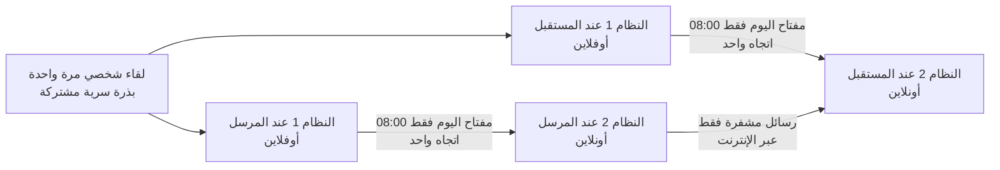

<div dir="rtl">

# تشفير بمفاتيح تتغيّر آليًا وبشكل متزامن (نموذج أولي)

## الفكرة الأصلية

عند إرسال رسالة مشفرة، إذا استطاع مخترق تتبّع الرسائل والوصول إلى طريقة فك تشفيرها، فإنه يقرأ كل شيء.
الفكرة: نضيف **نظامًا أوفلاين مستقلًا (رقم 1)** إلى جانب **النظام الأونلاين (رقم 2)**.
في وقت محدد (مثلًا الساعة 8 صباحًا) يتصل النظام 1 بالنظام 2 لحظة واحدة **ليغيّر التشفير بطريقة عشوائية**، ثم ينفصل.
يحدث الشيء نفسه عند المرسل وعند المستقبل في الوقت نفسه، فيبقيان متزامنين دون أن يتمكن أحد من تتبّع التغيير.

## هل الفكرة صحيحة؟

**نعم، والاتجاه صحيح.** هذا النوع من الحلول مستعمل فعلًا في أنظمة حقيقية:

| النظام الحقيقي | ما يشترك فيه مع فكرتك |
|---|---|
| تطبيقات الرموز المؤقتة (Google Authenticator) | سرّ مشترك + الساعة = رمز جديد متطابق عند الطرفين دون أي تواصل |
| المفاتيح الجذرية في البنوك والشركات | المفتاح الأهم محفوظ في جهاز **غير متصل** ولا يُستعمل إلا عند الحاجة |
| تطبيق Signal | المفتاح يتغيّر باستمرار، فسرقة مفتاح واحد لا تكشف الرسائل الأخرى |

لكن لكي تصبح الفكرة آمنة فعلًا، تحتاج إلى **ثلاثة تعديلات**، وقد طُبّقت في هذا النموذج:

### التعديل 1: نغيّر "المفتاح" وليس "المعادلة"

اختراع معادلات تشفير جديدة عشوائيًا يُنتج غالبًا تشفيرًا ضعيفًا يمكن كسره.
الحل المعتمد عالميًا: نستعمل خوارزمية واحدة مجرَّبة ومدروسة جيدًا (**AES-256**) ونغيّر **مفتاحها**.

والمهم هنا: خوارزمية AES مع مفتاح معيّن هي في الحقيقة **دالة تشفير** مختلفة.
عدد المفاتيح الممكنة هو 2<sup>256</sup>، أي رقم من 78 خانة. إذًا عندما نغيّر المفتاح، فنحن فعلًا **نختار عشوائيًا دالة جديدة من بين عدد هائل من الدوال**، وهذه هي فكرتك نفسها، لكن بدوال لم ينجح أحد في كسرها منذ أكثر من 20 سنة.

> قاعدة كيركهوفس (Kerckhoffs): يجب أن يبقى النظام آمنًا حتى لو عرف المخترق كل تفاصيله ما عدا المفتاح.

### التعديل 2: "عشوائي بحت" و"متزامن" يحتاجان إلى بذرة مشتركة

إذا اختار كل طرف رقمًا عشوائيًا بمفرده، فلن يحصلا على الرقم نفسه أبدًا.
الحل: عند **اللقاء الأول (مرة واحدة فقط)** نُنشئ **بذرة سرية عشوائية** ويأخذ كل طرف نسخة منها.
بعد ذلك يحسب كل طرف مفتاح كل يوم من البذرة بـ**دالة باتجاه واحد**:

```
بذرة → سلسلة(1) → سلسلة(2) → سلسلة(3) → ...
           ↓          ↓          ↓
       مفتاح(1)   مفتاح(2)   مفتاح(3)
```

- **لمن لا يملك البذرة:** المفاتيح تبدو عشوائية تمامًا، ولا يمكن توقّع مفتاح الغد من مفتاح اليوم.
- **للمرسل والمستقبل:** يحصلان على المفتاح نفسه بالضبط، في الوقت نفسه، **دون أن يتواصلا**.
- **الأسهم تسير في اتجاه واحد فقط:** بعد كل تغيير تُتلف الخزنة حالتها القديمة. لذلك حتى لو سُرقت الخزنة اليوم، لا يستطيع السارق حساب مفاتيح الأيام الماضية.

### التعديل 3: النقل من النظام 1 إلى النظام 2 في اتجاه واحد فقط

إذا "اتصل" النظام الأوفلاين بالأونلاين في الاتجاهين، فقد ينتقل فيروس من الأونلاين إلى الأوفلاين عبر ذلك الاتصال.
الحل: النظام 1 **يُخرج** مفتاح اليوم فقط ولا **يستقبل** أي شيء. أفضل طريقة عملية: يعرض رمز QR على شاشته وتقرؤه كاميرا الهاتف.
في هذا النموذج يُحاكى النقل بمجلد (كأنه فلاشة)، ويُمسح المفتاح من المجلد فور استيراده.

## كيف يعمل النظام



1. **مرة واحدة:** لقاء شخصي، إنشاء البذرة، وكل طرف يضع نسخته في جهازه الأوفلاين.
2. **كل يوم الساعة 08:00 (آليًا):** كل خزنة تحسب مفتاح اليوم وحدها، تُخرجه للنظام المتصل، وتُتلف حالتها القديمة.
3. **النظام المتصل** يشفّر الرسائل بمفتاح اليوم (AES-256-GCM)، ويكتب رقم اليوم في رأس الرسالة ليعرف المستقبل أي مفتاح يستعمل.
4. **النظام المتصل يحتفظ بمفتاحين فقط:** مفتاح اليوم ومفتاح الأمس (حتى لا تضيع رسالة أُرسلت الساعة 07:59 ووصلت 08:01)، ويُتلف ما هو أقدم.
5. إذا لم يُستورد مفتاح اليوم، **يرفض النظام التشفير** بالمفتاح القديم.

## ماذا يحمي هذا النظام؟ وماذا لا يحمي؟

| السيناريو | النتيجة |
|---|---|
| مخترق يسجّل كل الرسائل التي تمر عبر الإنترنت | ✅ لا يستطيع قراءتها |
| مخترق يعدّل حرفًا في رسالة | ✅ تُكتشف وتُرفض تلقائيًا |
| اختراق الجهاز المتصل (النظام 2) وسرقة مفاتيحه | ⚠️ يقرأ رسائل اليوم والأمس فقط، وينتهي أثر الاختراق عند التغيير التالي |
| سرقة الخزنة الأوفلاين (النظام 1) | ⚠️ الماضي محمي، لكن السارق يستطيع حساب مفاتيح المستقبل، فيجب إنشاء بذرة جديدة فورًا |
| فيروس يقرأ الشاشة بعد فك التشفير | ❌ لا يوجد تشفير يحمي من هذا |
| إعادة إرسال رسالة قديمة مسجّلة (Replay) خلال نافذة اليومين | ❌ غير محمي في هذا النموذج (تحسين لاحق) |
| ساعة أحد الجهازين خاطئة | ⚠️ يفقد الطرفان التزامن، لذلك يحتاج الجهاز الأوفلاين إلى ساعة دقيقة |

**ملاحظة مهمة:** التشفير الحديث (مثل AES) لا يُكسر بمجرد تتبّع الرسائل. الخطر الحقيقي هو **سرقة المفتاح**، وهنا تكمن القيمة الحقيقية لفكرتك: إبقاء السرّ الأساسي بعيدًا عن الإنترنت، **وتصغير الضرر** إذا سُرق مفتاح.

## التجربة

تحتاج إلى Python 3.9 أو أحدث:

```bash
cd synced-key-rotation
pip install -r requirements.txt

python demo.py              # محاكاة كاملة على 6 أيام: مرسل، مستقبل، ومخترق
python -m unittest -v       # 14 اختبارًا آليًا
```

### الاستعمال اليدوي بالأوامر

```bash
# 1) مرة واحدة: اللقاء الأول (ينشئ ملفين متطابقين، واحد لكل طرف)
python offline_vault.py pair --me ahmed_vault.json --peer sara_vault.json --rotation-hour 8

# 2) كل يوم عند موعد التغيير، على الجهاز الأوفلاين:
python offline_vault.py release --vault ahmed_vault.json --out /media/usb

# 3) على الجهاز المتصل: استيراد مفتاح اليوم (يُمسح من الفلاشة تلقائيًا)
python online_node.py import --node ahmed_node.json --from /media/usb

# 4) التشفير وفك التشفير
python online_node.py encrypt --node ahmed_node.json "رسالتي السرية"
python online_node.py decrypt --node sara_node.json "AQAAAA..."
```

**الأتمتة (التغيير الآلي عند الساعة 8):** على جهاز لينكس أوفلاين، أضف هذا السطر بالأمر `crontab -e`:

```
0 8 * * * cd /path/to/synced-key-rotation && python3 offline_vault.py release --vault vault.json --out /media/usb
```

> ساعة التغيير في البرنامج تُحسب بتوقيت **UTC** حتى يتزامن الطرفان ولو كانا في بلدين مختلفين.
> مثال: إذا كان توقيتك UTC+1، فالساعة 08:00 عندك هي 07:00 UTC، فاستعمل `--rotation-hour 7`.

## الملفات

| الملف | الدور |
|---|---|
| `offline_vault.py` | **النظام 1**: الخزنة الأوفلاين (البذرة، السلسلة، إخراج مفتاح اليوم) |
| `online_node.py` | **النظام 2**: النظام المتصل (استيراد المفتاح، التشفير، فك التشفير) |
| `common.py` | الجدول الزمني المشترك، والبصمات، والكتابة الآمنة للملفات |
| `demo.py` | محاكاة كاملة للسيناريوهات |
| `test_system.py` | الاختبارات الآلية |

## الخطوات التالية لتحويله إلى نظام حقيقي

1. **نقل المفتاح برمز QR** بدل الفلاشة، ليصبح النقل في اتجاه واحد فعلًا.
2. **جهاز أوفلاين مخصص:** مثلًا Raspberry Pi بلا Wi-Fi وبلا Bluetooth، مع وحدة ساعة دقيقة (RTC)، أو مفتاح أمان مادي.
3. **إضافة تبادل Diffie-Hellman عند كل تغيير:** يولّد كل طرف رقمًا عشوائيًا جديدًا ويرسل "نصفه العام" عبر الإنترنت (وهذا آمن). بهذا تصبح التغييرات **عشوائية بحتة** كما في فكرتك الأصلية، وحتى من سرق الخزنة يُطرد عند التبادل التالي. هذا ما يفعله تطبيق Signal.
4. **منع إعادة الإرسال (Replay):** إضافة عدّاد لكل رسالة.
5. **مراجعة أمنية** من مختصين قبل الاعتماد عليه في أسرار حقيقية.

> ⚠️ **تنبيه:** هذا نموذج تعليمي يجسّد الفكرة ويثبت أنها تعمل. للمراسلات الحساسة الحقيقية اليوم، استعمل تطبيقًا مجرّبًا مثل **Signal**، فهو يطبّق نسخة أكثر تطورًا من الفكرة نفسها: المفتاح يتغيّر **مع كل رسالة** وليس كل يوم.

</div>
