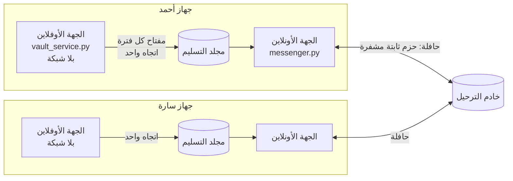
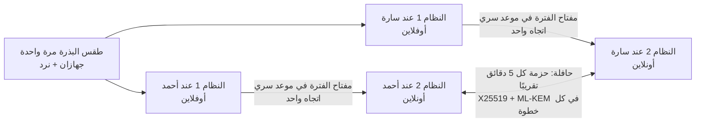

<div dir="rtl">

# تشفير بمفاتيح تتغيّر في مواعيد سرية وبعشوائية حقيقية، ومقاوم للحاسوب الكمّي (نموذج أولي)

## الفكرة الأصلية

عند إرسال رسالة مشفرة، إذا استطاع مخترق تتبّع الرسائل والوصول إلى طريقة فك تشفيرها، فإنه يقرأ كل شيء.
الفكرة: نضيف **نظامًا أوفلاين مستقلًا (رقم 1)** إلى جانب **النظام الأونلاين (رقم 2)**.
في أوقات معينة يتصل النظام 1 بالنظام 2 لحظة واحدة **ليغيّر التشفير بطريقة عشوائية**، ثم ينفصل.
يحدث الشيء نفسه عند المرسل وعند المستقبل في الوقت نفسه، فيبقيان متزامنين دون أن يتمكن أحد من تتبّع التغيير.

## هل الفكرة صحيحة؟

**نعم.** جوهرها مستعمل في أنظمة حقيقية:

| النظام الحقيقي | ما يشترك فيه مع فكرتك |
|---|---|
| تطبيقات الرموز المؤقتة (Google Authenticator) | سرّ مشترك + الساعة = رمز جديد متطابق عند الطرفين دون أي تواصل |
| المفاتيح الجذرية في البنوك والشركات | المفتاح الأهم محفوظ في جهاز **غير متصل** |
| شبكة WireGuard | "مفتاح مشترك مسبقًا" اختياري لمقاومة الحاسوب الكمّي، مثل خزنتك تمامًا |
| تطبيق Signal و iMessage | عشوائية جديدة مع كل تبادل للكلام، ومفتاح لكل رسالة، وحماية من الحاسوب الكمّي |

## طبقات الحماية الإحدى عشرة

| # | الطبقة | ماذا تفعل |
|---|---|---|
| 1 | **نغيّر المفتاح لا المعادلة** | خوارزميات عالمية مجرَّبة؛ تغيير المفتاح = اختيار دالة جديدة من بين 2<sup>256</sup> دالة |
| 2 | **طقس البذرة** | البذرة المشتركة مزيج من 3 مصادر عشوائية مستقلة: جهازان + رميات نرد |
| 3 | **مواعيد تغيير سرية** | كل تغيير بعد مدة عشوائية (بين ساعتين و10 ساعات، بدقة الثانية) لا يعرفها إلا الطرفان |
| 4 | **مصافحة هجينة عند كل تغيير** | ثلاثة أقفال: مفتاح الخزنة + X25519 + ML-KEM؛ حتى سرقة الخزنة لا تكفي |
| 5 | **عشوائية مع كل تبادل للكلام** | السقّاطة المزدوجة الهجينة: الهاتف المسروق يفقد قيمته بعد تبادل أو تبادلين |
| 6 | **مفتاح لكل رسالة** | يُتلف لحظة قراءتها: الرسائل المقروءة محمية، والرسالة المكررة تُرفض |
| 7 | **طبقتا تشفير** | AES-256 داخل ChaCha20، لكل منهما مفتاحها: يجب كسر الخوارزميتين معًا |
| 8 | **إخفاء الآثار** | كل الحزم بطول ثابت ومشفّرة بالكامل: لا نوع، ولا طول، ولا رقم ظاهر |
| 9 | **الحافلة والحزم الوهمية** | حزمة كل 5 دقائق في المتوسط، تكلمتما أو صمتّما: لا يظهر متى تتراسلان ولا كم |
| 10 | **النقل في اتجاه واحد** | الخزنة الأوفلاين تُخرج ولا تستقبل شيئًا أبدًا |
| 11 | **مقاومة الحاسوب الكمّي** | ML-KEM-1024 مع X25519 في المصافحة وفي كل خطوة سقّاطة، فوق مفتاح الخزنة |

## التطبيق: جهة أوفلاين وجهة أونلاين على الجهاز نفسه

بعد التثبيت والاقتران يكون في كل جهاز **جهتان مستقلتان تعملان وحدهما**:



**الجهة الأوفلاين (`vault_service.py`):**
- **تبدأ وحدها** فور التشغيل، **دون أي إذن**، ودون أن يسألها أحد.
- **تغيّر المفاتيح وحدها** في المواعيد السرية العشوائية، حسب **ساعة الجهاز**، وتُتلف القديم.
- **تكتب فقط** في مجلد التسليم، و**لا تقرأ شيئًا** من الجهة الأونلاين: الطريق باتجاه واحد.
- **معزولة عن الشبكة:**
  - في لينكس **يفرض نظام التشغيل العزل**: تعمل في "فضاء شبكة" فارغ لا يحتوي أي اتصال. تحققنا من ذلك فعليًا: كانت كل جهة أوفلاين في فضاء شبكة خاص بها.
  - وتمنع نفسها داخل البرنامج أيضًا، فأي محاولة لفتح اتصال تفشل.
  - على الأنظمة الأخرى يبقى العزل البرمجي فقط، والواجهة تقول ذلك بوضوح.

**الجهة الأونلاين (`messenger.py`):**
- **تأخذ المفاتيح** من مجلد التسليم وحدها.
- **تشغّل الحافلة** وتتراسل عبر الخادم.
- **تعرض في الواجهة حالة الجهة الأوفلاين:** تعمل أم متوقفة، ونوع عزلها.

**الوقت من ساعة الجهاز**، مع ضمانات:
- كل مصافحة تحمل وقت المرسل **داخل الجزء المشفّر**. إذا كانت ساعة الطرف الآخر متقدّمة على ساعتك بأكثر من دقيقتين، يظهر تحذير.
- التأخير في الطريق يجعل التقدير أصغر من الحقيقة، فلا يظهر تحذير خاطئ أبدًا.
- الخزنة لا ترجع إلى الوراء أبدًا. ومن يتلاعب بساعة جهازك يستطيع **تعطيل** المراسلة، لكنه **لا يستطيع قراءتها**.

**خطوة واحدة لا يمكن حذفها: الاقتران مرة واحدة.** لا أحد يستطيع مشاركة سرّ مع شخص دون أن يتبادلا شيئًا ولو مرة:
- جهاز الطرف الأول يعرض **رمزًا** (حوالي 70 حرفًا) يحمل البذرة والجدول السري.
- الطرف الثاني يكتبه بيده، **بلا أي إذن ولا كاميرا**.
- الرمز يحمل بصمة تحقق تكشف أي خطأ في الكتابة، ولا يُحفظ في أي مكان بعد عرضه.

```bash
# أحمد (مرة واحدة): ينشئ الاقتران ويعرض الرمز
python secure_app.py create --home ahmed
# سارة (مرة واحدة): تكتب الرمز
python secure_app.py join --home sara --code "XXXX-XXXX-..."
# بعدها، كل واحد على جهازه: تشغيل الجهتين معًا
python secure_app.py start --home ahmed --relay https://<عنوان الخادم> --name أحمد
```

**ماذا نخسر مقارنة بجهاز منفصل؟**

| ضد | جهاز منفصل | على الجهاز نفسه |
|---|---|---|
| مخترق عن بعد يهاجم الخزنة | ✅ | ✅ (لا شبكة لها) |
| برنامج خبيث عادي | ✅ | ✅ على أندرويد (ملفات كل تطبيق محمية). ⚠️ على الحاسوب البرامج التي تعمل باسم المستخدم نفسه تستطيع قراءة الملف |
| فيروس سيطر على الجهاز كليًا | ✅ | ❌ (الحل لاحقًا: قفل ملف الخزنة بالشريحة الأمنية للجهاز) |

وفي كل الحالات تبقى أقفال X25519 وML-KEM والسقّاطة تعمل.

**خادم الترحيل (`relay_server.py`):** صناديق بريد تحفظ الحزم حتى يأخذها صاحبها. لا يسجّل شيئًا، ويحذف ما لم يُستلم خلال 24 ساعة.

| يرى الخادم | لا يرى |
|---|---|
| حزمًا بطول ثابت (6144 بايت) تصل في مواعيد عشوائية | المحتوى، ولا النوع (رسالة أم وهمية أم مصافحة)، ولا الطول |
| أرقام صناديق عشوائية | من يملك الصندوق: رقمه سري ومشتق من مفتاح الفترة، **ويتغيّر مع كل تغيير سري** |
| عنوان الجهاز المتصل (IP) وأوقات الاتصال | (في نسخة أندرويد مع صندوق في أحد الهاتفين: لا أحد يرى عنوان IP، فكل شيء يمر عبر Tor) |

**الواجهة المحلية:**
- تعمل على هذا الجهاز فقط (127.0.0.1).
- تطلب رمزًا سريًا عشوائيًا يتغيّر عند كل تشغيل، وترفض أي طلب من موقع آخر.
- الرسائل تُحفظ **في الذاكرة فقط** وتختفي عند إغلاق التطبيق.

### التجربة بأمر واحد

```bash
python try_locally.py
```

يحاكي جهازين بالخطوات الحقيقية نفسها: أحمد ينشئ الاقتران، وسارة تنضم بالرمز، ثم يشغّل كل منهما الجهتين. تُفتح صفحتان في المتصفح، فاكتب في إحداهما وانظر الرسالة تصل إلى الأخرى.

في وضع التجربة السريع: تغيير سري كل 2 إلى 4 دقائق، وحافلة كل 3 إلى 8 ثوانٍ. أوقف كل شيء بـ Ctrl+C.

### الخادم بين جهازين

- **داخل شبكة منزلية واحدة (للتجربة):** `python relay_server.py --host 0.0.0.0 --port 8000`
- **على الإنترنت:** خادم مستأجر مع **HTTPS إلزاميًا** (شهادة مجانية من Let's Encrypt): `python relay_server.py --host 0.0.0.0 --port 443 --tls-cert cert.pem --tls-key key.pem`

**حدود هذا الإصدار:**
- **نسخة حاسوب:** يعمل على الحاسوب، ونسخة أندرويد خطوة قادمة.
- **الإشعارات:** لا توجد إشعارات.
- **تعطل الخادم:** توقف المراسلة، لكن الحزم تنتظر في التطبيق ثم تُرسل عند عودته.
- **الصناديق:** من يعرف رقم صندوق يستطيع حذف حزمه، لا قراءتها.

## التفاصيل

### 1. نغيّر "المفتاح" وليس "المعادلة"

اختراع معادلات تشفير جديدة يُنتج غالبًا تشفيرًا ضعيفًا. الحل المعتمد عالميًا: خوارزميات مجرَّبة ومدروسة، ونغيّر **مفاتيحها**.
خوارزمية AES مع مفتاح معيّن هي **دالة تشفير** مختلفة، وعدد المفاتيح الممكنة 2<sup>256</sup> (رقم من 78 خانة). إذًا تغيير المفتاح هو فعلًا **اختيار عشوائي لدالة جديدة**، وهذه هي فكرتك نفسها، لكن بدوال لم يكسرها أحد.

> قاعدة كيركهوفس (Kerckhoffs): يجب أن يبقى النظام آمنًا حتى لو عرف المخترق كل تفاصيله ما عدا المفتاح.

### 2. طقس البذرة: عشوائية من ثلاثة مصادر

يحتاج الطرفان إلى **بذرة سرية مشتركة** تُصنع مرة واحدة في لقاء شخصي، بمزج:
- عشوائية جهاز الطرف الأول (256 بت)،
- عشوائية جهاز الطرف الثاني (256 بت)،
- **100 رمية نرد حقيقية** (حوالي 258 بت).

المزج يأخذ **قوة أقوى مصدر**: يكفي أن يكون مصدر واحد سليمًا وسريًا. فلو كان مولّد أحد الجهازين معطوبًا، كما حدث فعلًا في خطأ Debian سنة 2008، أنقذه النرد.

وكل رقم عشوائي يمر قبل استعماله بـ**فحص صحة**: إذا أعطى المولّد أصفارًا أو كرر نتيجة سابقة (كما حدث لجهاز PlayStation 3 سنة 2010)، يتوقف البرنامج بدل أن يصنع مفاتيح ضعيفة بصمت.

### 3. مواعيد تغيير سرية وغير منتظمة

مدة كل فترة تُحسب من السلسلة السرية نفسها: رقم بين ساعتين و10 ساعات، بدقة الثانية، مثلًا:

```
التغيير 1: 02:25:17   (بعد 6.42 ساعة)
التغيير 2: 05:23:15   (بعد 2.97 ساعة)
التغيير 3: 10:45:04   (بعد 5.36 ساعة)
```

الطرفان يحسبان المواعيد نفسها بالضبط دون أن يتواصلا، أما المخترق فلا يستطيع توقّعها.

### 4. مصافحة هجينة عند كل تغيير: ثلاثة أقفال

عند كل تغيير يتفق الطرفان على أسرار جديدة **دون أن تمر هذه الأسرار نفسها عبر الإنترنت**، بطريقتين معًا:

- **X25519 (Diffie-Hellman)، وشرحه بالألوان:** يختار كل طرف لونًا سريًا ويمزجه بلون أصفر متفق عليه، ثم يرسل الخليط علنًا. يضيف كل طرف لونه السري إلى خليط الآخر، فيحصلان على اللون نفسه. المخترق يرى الخليطين فقط، وفصل الألوان مستحيل عمليًا.
- **ML-KEM-1024، وشرحه بالقفل:** ترسل سارة قفلًا مفتوحًا. يضع أحمد سرًا عشوائيًا في صندوق ويقفله بقفلها، ثم يرسل الصندوق. وحدها سارة تستطيع فتحه.

**مفتاح الفترة = مزج (مفتاح الخزنة + سرّ X25519 + سرّ ML-KEM)**

لذلك تحتاج المصافحة الآن **ثلاث خطوات**: أحمد يرسل نصفه، وسارة ترسل نصفها وقفلها، ثم أحمد يرسل الصندوق. والمصافحة كلها مشفرة بمفاتيح مشتقة من مفتاح الخزنة، فمن لا يملك الخزنة لا يستطيع دسّ نصف أو قفل مزيف.

### 5. عشوائية جديدة مع كل تبادل للكلام (السقّاطة المزدوجة الهجينة)

داخل كل فترة، **كل حزمة تحمل نصف مرسلها الحالي، وقفله الحالي، وصندوقًا مقفلًا بآخر قفل وصله من الطرف الآخر**. عندما يصلك نصف جديد:
1. تفتح الصندوق بقفلك، وتمزج سرّه مع سرّ X25519.
2. ثم تولّد نصفًا جديدًا وقفلًا جديدًا، وتضع سرًا جديدًا في صندوق مقفل بقفل الطرف الآخر.

هكذا تدخل عشوائية حقيقية جديدة **مع كل تبادل للكلام**، من الطريقتين معًا.

لماذا "مع كل تبادل" وليس "مع كل رسالة"؟ لأن تبادل الأسرار يحتاج إلى مشاركة من **الطرفين**. فالرسائل المتتالية دون رد تستعمل سلسلة محسوبة (الطبقة 6)، والعشوائية الجديدة تدخل مع أول رد.

**النتيجة في المحاكاة:** سُرقت نسخة كاملة من هاتف سارة. قرأ السارق رسالتين جديدتين، ثم فشل نهائيًا بمجرد أن دخلت السلسلةَ أسرارٌ وُلدت على هاتف سارة **بعد** السرقة، دون انتظار التغيير السري التالي. ومع الحافلة (الطبقة 9) يحدث هذا خلال دقائق حتى لو لم يكتب أحد شيئًا.

هذه الطبقة تتّبع مواصفات **Double Ratchet** المنشورة والمدروسة (Perrin و Marlinspike، 2016)، مع إضافة ML-KEM في كل خطوة على طريقة Apple PQ3 وSignal SPQR، وسلسلة أولى للطرف الثاني كي يستطيع أي من الطرفين أن يبدأ الكلام.

### 6. مفتاح جديد لكل رسالة

```
سلسلة → سلسلة → سلسلة → ...
  ↓        ↓        ↓
رسالة 0  رسالة 1  رسالة 2
```

- مفتاح كل رسالة **يُتلف لحظة إرسالها أو قراءتها**: من يسرق الهاتف لا يقرأ أي رسالة سبق إرسالها أو قراءتها.
- إعادة إرسال رسالة مسجّلة (Replay) تُرفض، لأن مفتاحها لم يعد موجودًا.
- الرسائل التي تصل بغير ترتيبها تُقرأ عاديًا، حتى عبر عدة تبادلات.

مفاتيح السلسلة **محسوبة**، ولهذا تحمي **الماضي**. أما **المستقبل** فتحميه العشوائية الجديدة (الطبقتان 4 و5).

### 7. طبقتا تشفير بخوارزميتين مختلفتين

```
الحمولة ← AES-256-GCM ← ChaCha20-Poly1305 ← الإنترنت
```

لكل طبقة مفتاحها المستقل، والخوارزميتان معياران عالميان بتصميم رياضي مختلف. وضع القفلين معًا (لا التبديل بينهما) يجعل اللص مضطرًا لكسر الاثنين. في المحاكاة نتخيّل أن المخترق كسر ChaCha20 بالكامل، فيجد تحتها نصًا ما زال مشفرًا بـ AES.

### 8. إخفاء الآثار

- كل حزمة **6144 بايت بالضبط**: المصافحة، والرسالة القصيرة، والطويلة (حتى 2898 بايت، أي حوالي 1450 حرفًا عربيًا)، والحزمة الوهمية.
- **الرأس مشفّر أيضًا**: المراقب لا يرى رقم الفترة، ولا رقم الرسالة، ولا الأنصاف، ولا الأقفال، ولا الصناديق، ولا هل الحزمة مصافحة أم رسالة أم وهمية.

### 9. الحافلة والحزم الوهمية

التشفير وحده لا يخفي **متى** و**كم** تتراسلان. الحل "حافلة":

| | 🚕 سيارة أجرة (بدون حافلة) | 🚌 الحافلة |
|---|---|---|
| **الطريقة** | كل رسالة تنطلق فورًا | حزمة تنطلق في مواعيد عشوائية (كل 2.5 إلى 7.5 دقيقة، 5 في المتوسط)، حقيقية أو وهمية؛ الرسالة تنتظر الحافلة التالية |
| **ما يراه المراقب** | المحادثات ولحظات التغيير مكشوفة | التدفق نفسه دائمًا |

**مثال من المحاكاة (`bus_demo.py`)**، حيث كل رمز = 10 دقائق، والرقم = عدد الحزم التي يراها المراقب:

```
ما حدث فعلًا:   K·····CC···!········K···C···········     (C محادثة، K تغيير سري، ! سرقة)
بدون حافلة:     2·····33············2···4···········
مع الحافلة:     353545444444534545555434363444345363
```

- **تفاصيل ذكية:**
  - عدة رسائل قصيرة تركب الحافلة نفسها معًا.
  - المصافحة عند التغيير السري تركب الحافلة أيضًا، فتختفي لحظة التغيير.
  - إذا لم يتوفر مفتاح، تنطلق حزمة ضجيج بالشكل نفسه، فلا تظهر فجوة في المواعيد.
- **علامة "وهمية" مخفية داخل الجزء المشفّر بمفتاح الرسالة**، وهذا المفتاح يُتلف بعد القراءة. فحتى من يسرق الهاتف لاحقًا لا يميّز الحزم الوهمية القديمة من الحقيقية.
- **الحزم الوهمية تحمل أنصافًا وأقفالًا جديدة أيضًا**، فتتجدد المفاتيح حتى في الصمت. في عشرات التشغيلات للمحاكاة، فقد السارق القدرة خلال دقائق (من أقل من دقيقة إلى 12 دقيقة)، ولم يقرأ أي رسالة حقيقية.
- **الثمن:**
  - انتظار حوالي 3 دقائق في المتوسط لكل رسالة، وأطول قليلًا بعد التغيير السري حتى تكتمل المصافحة.
  - حوالي **2.4 ميغابايت في اليوم لكل اتجاه**.
  - استيقاظ الهاتف بانتظام، وهذا يستهلك شيئًا من البطارية.

### 10. النقل من النظام 1 إلى النظام 2 في اتجاه واحد

النظام 1 **يُخرج** مفتاح الفترة ولا **يستقبل** أي شيء، فلا يستطيع فيروس الانتقال إليه من الجهاز المتصل. أفضل وسيلة عملية للنقل: رمز QR تعرضه شاشة الخزنة وتقرؤه كاميرا الهاتف. في هذا النموذج يُحاكى النقل بمجلد (كأنه فلاشة)، ويُمسح المفتاح منه فور استيراده.

### 11. مقاومة الحاسوب الكمّي

**ماذا يكسر الحاسوب الكمّي؟**

| ما نستعمله | أثر الحاسوب الكمّي |
|---|---|
| X25519 | ❌ يُكسر (خوارزمية Shor) |
| AES-256، ChaCha20، HMAC-SHA256 (الخزنة والسلاسل) | ✅ قوتها تنزل إلى 128 بت، وهذا ما زال مستحيل الكسر (خوارزمية Grover) |
| ML-KEM-1024 | ✅ لا يُعرف أي حاسوب، كمّي أو عادي، يكسره (معيار NIST منذ 2024، قوته تعادل AES-256) |

الخطر الحقيقي اليوم: "**سجّل الآن، واكسر لاحقًا**". لا يوجد اليوم حاسوب كمّي قادر على ذلك، ولا أحد يعرف متى سيظهر.

**الخزنة كانت تحمي من معظم الخطر:** كل مفتاح ممزوج بمفتاح الخزنة الذي لم يمر عبر الإنترنت، والأنصاف نفسها داخل حزم مشفرة بمفاتيح الخزنة. فالمخترق الذي يسجّل كل شيء لا يستفيد من الحاسوب الكمّي وحده. بقيت الثغرة في "الكارثة المزدوجة": **سرقة + حاسوب كمّي**. وهذا ما يسدّه ML-KEM.

**لماذا هجين (X25519 + ML-KEM) وليس ML-KEM وحده؟** لأن ML-KEM جديد نسبيًا. وفي 2022 كُسرت خوارزمية أخرى كانت مرشحة للمقاومة الكمّية (SIKE) في حوالي ساعة على حاسوب عادي. فيجب كسر الاثنين معًا.

**ماذا أثبتت الاختبارات (بمحاكاة حاسوب كمّي يعطي المخترق أسرار X25519):**

| ما يملكه المخترق | النتيجة |
|---|---|
| الخزنة + كسر X25519 (كمّي) | ❌ لا يحسب مفتاح الفترة: ينقصه ML-KEM |
| الخزنة + كسر ML-KEM | ❌ ينقصه X25519 |
| كسر الخوارزميتين معًا، بلا خزنة | ❌ تنقصه الخزنة |
| الهاتف المسروق + كسر X25519 (كمّي) | ❌ يتقدّم خطوة واحدة، ثم يتوقف عند أول صندوق مقفل بقفل وُلد بعد السرقة |

**تفاصيل صريحة:**
- مفاتيح ML-KEM الخاصة تُبنى من مولّدنا المفحوص. أما السرّ الذي يوضع في الصندوق فتولّده مكتبة التشفير نفسها (OpenSSL).
- **ثمن الحجم:** القفل والصندوق 1568 بايت لكل منهما. لهذا كبُرت الحزم إلى 6144 بايت، وأصبحت المصافحة ثلاث خطوات بدل خطوتين.

## دراسة العشوائية (`randomness_lab.py`)

هل "يبدو عشوائيًا" يعني "لا يمكن تتبّعه"؟ يأخذ المختبر 3 مولّدات، ويطبّق عليها الاختبارات الإحصائية نفسها، ثم يهاجمها:

| المولّد | الاختبارات الإحصائية | الهجوم |
|---|---|---|
| **سلسلتنا** (HMAC-SHA256) | ✅ نجح | ✅ لا طريق مختصر معروف: التخمين يحتاج 3.7×10<sup>41</sup> سنة بكل حواسيب العالم |
| مولّد بايثون العادي | ✅ نجح | ❌ بعد مراقبة 78 مفتاحًا، تنبّأ المخترق بالمفاتيح التالية بالضبط |
| محاكاة خطأ Debian | ✅ نجح | ❌ كُشف السرّ في أقل من 0.02 ثانية |

**الدرس:** الاختبارات الإحصائية لا تستطيع التمييز بين العشوائية القوية والضعيفة. عدم القدرة على التتبع يأتي من شرطين: **عشوائية حقيقية كافية في المصدر**، و**حساب باتجاه واحد**.

## كيف يعمل النظام



1. **مرة واحدة:** طقس البذرة في لقاء شخصي؛ كل طرف يأخذ خزنته.
2. **عند كل موعد سري:** كل خزنة تحسب مفتاح الفترة وحدها، تُخرجه في اتجاه واحد، وتُتلف حالتها القديمة.
3. **المصافحة الهجينة (تركب الحافلة):** الأنصاف، والقفل، والصندوق. عند اكتمالها يُحسب مفتاح الفترة من الأقفال الثلاثة، ويُتلف هو ومفتاح الخزنة.
4. **السقّاطة المزدوجة الهجينة:** مع كل تبادل نصف وقفل وصندوق جديد؛ ولكل رسالة مفتاحها الذي يُتلف بعد استعماله.
5. **الحافلة:** تنطلق في مواعيد عشوائية، حاملة الرسائل المنتظرة أو لا شيء.
6. **كل حزمة:** طبقتا تشفير، ورأس مخفي، وطول ثابت.
7. **الرسائل المتأخرة** تُقبل حتى 12 ساعة بعد انتهاء فترتها؛ بعدها تُتلف مفاتيح الفترة كلها.

## ماذا يحمي هذا النظام؟ وماذا لا يحمي؟

| السيناريو | النتيجة |
|---|---|
| مخترق يسجّل كل ما يمر عبر الإنترنت (حتى مع حاسوب كمّي لاحقًا) | ✅ لا يقرأ شيئًا، ولا يعرف نوع الحزم ولا أطوالها، ولا متى تتكلمان |
| مخترق يدسّ مصافحة مزيفة أو يعدّل حرفًا | ✅ تُكتشف وتُرفض، ولا تتأثر حالة النظام |
| إعادة إرسال رسالة مسجّلة (Replay) | ✅ تُرفض |
| سرقة الهاتف المتصل (حتى مع حاسوب كمّي) | ✅ الرسائل المقروءة محمية. ⚠️ يقرأ ما يصل بعد السرقة حتى تدخل أسرار جديدة: **دقائق** مع الحافلة |
| سرقة الخزنة الأوفلاين (حتى مع حاسوب كمّي) | ✅ الماضي والمستقبل محميان من المراقب الصامت. ⚠️ إذا تحكّم أيضًا في الشبكة يستطيع الانتحال، فيجب إعادة الاقتران |
| كسر إحدى الخوارزميات يومًا ما | ✅ الأخرى تبقى تحمي (AES مع ChaCha20، و X25519 مع ML-KEM) |
| معرفة موعد التغيير القادم | ✅ سري ومخفي بين الحافلات. ⚠️ الجهاز المتصل يعرف موعد التغيير **التالي فقط** |
| معرفة **أن** جهازك يتصل بجهاز سارة | ✅ في نسخة أندرويد مع صندوق ‎`.onion`: المراقب يرى أنك تستعمل Tor فقط، ولا يعرف أي هاتف عنوان الآخر. ⚠️ جهة تراقب طرفي الإنترنت معًا قد تربط بينهما بالتوقيت (حد معروف في Tor، والحافلة تصعّبه). ❌ على الحاسوب ما زال الخادم يرى العناوين |
| مخترق سرق الحالة **ويتدخل بنشاط** في الشبكة | ⚠️ قد يمنع الشفاء؛ حد معروف حتى في Signal |
| فيروس يبقى داخل الجهاز، أو يقرأ الشاشة | ❌ لا يوجد تشفير يحمي من هذا |
| ساعة أحد الجهازين خاطئة | ⚠️ يفقد الطرفان التزامن؛ الجهاز الأوفلاين يحتاج إلى ساعة دقيقة. (إذا رجعت الساعة إلى الوراء قليلًا يتعامل النظام معها بأمان) |

**لكشف الانتحال:** الأمر `status` يعرض بصمة مفتاح الفترة. إذا قرأها الطرفان لبعضهما بالهاتف وكانت متطابقة، فلا أحد في المنتصف.

## التجربة

تحتاج إلى Python 3.9.2 أو أحدث، وإلى مكتبة `cryptography` بإصدار 50 أو أحدث (فيها ML-KEM):

```bash
cd synced-key-rotation
pip install -r requirements.txt

python demo.py              # الجزء الأول: كل أنواع الهجمات (حتى بحاسوب كمّي محاكى)
python bus_demo.py          # الجزء الثاني: الحافلة، وما يراه المراقب، والشفاء في دقائق
python randomness_lab.py    # مختبر العشوائية
python try_locally.py       # التطبيق الحقيقي: صفحتان في المتصفح تتراسلان عبر خادم
python -m unittest -v       # 72 اختبارًا آليًا
```

إذا ظهر خطأ يذكر `mlkem` أو `UnsupportedAlgorithm`، فحدّث المكتبة: `pip install -U cryptography`.

### الاستعمال اليدوي بالأوامر

الحافلة تحتاج إلى تطبيق يرسل عبر الإنترنت آليًا، وهذا غير موجود في النموذج (تُحاكى في `bus_demo.py`). أما يدويًا فالحزم تُنسخ وتُلصق:

```bash
# 1) مرة واحدة: طقس البذرة
#    على جهاز سارة: توليد عشوائيتها
python offline_vault.py contribute --out sara_random.json
#    على جهاز أحمد (بعد نقل الملف): الاقتران مع 100 رمية نرد حقيقية
python offline_vault.py pair --me ahmed_vault.json --peer sara_vault.json \
    --peer-randomness sara_random.json --dice "3 6 1 2 5 4 ..." \
    --min-hours 2 --max-hours 10

# 2) على الجهاز الأوفلاين: تشغيل مستمر يُخرج المفتاح عند كل موعد سري
python offline_vault.py watch --vault ahmed_vault.json --out /media/usb

# 3) على كل جهاز متصل: استيراد المفتاح؛ يطبع "مصافحتك" لترسلها للطرف الآخر
python online_node.py import --node ahmed_node.json --from /media/usb

# 4) استقبال أي حزمة (مصافحة أو رسالة أو وهمية: الشكل واحد)
#    المصافحة ثلاث خطوات: بعد أن يستقبل أحمد مصافحة سارة، يطبع له البرنامج
#    مصافحة جديدة تحمل الصندوق المقفل ليرسلها إليها.
python online_node.py receive --node ahmed_node.json "..."

# 5) إرسال رسالة، أو حزمة وهمية
python online_node.py send --node ahmed_node.json "رسالتي السرية"
python online_node.py dummy --node ahmed_node.json

# الحالة وبصمة المفتاح (للمقارنة بالهاتف)
python online_node.py status --node ahmed_node.json
```

## الملفات

| الملف | الدور |
|---|---|
| `offline_vault.py` | **النظام 1**: طقس البذرة، والسلسلة، والمواعيد السرية، وإخراج مفتاح الفترة |
| `online_node.py` | **النظام 2**: المصافحة الهجينة، والسقّاطة المزدوجة الهجينة، والطبقتان، والحزم الثابتة |
| `bus.py` | **الحافلة**: مواعيد انطلاق عشوائية، وحزم وهمية، وركوب المصافحات |
| `common.py` | العشوائية مع فحص الصحة، والدالة باتجاه واحد، والبصمات، والملفات |
| `demo.py` | المحاكاة 1: الهجمات والحماية، حتى بحاسوب كمّي محاكى |
| `bus_demo.py` | المحاكاة 2: ما يراه المراقب، وثمن الانتظار، والشفاء |
| `randomness_lab.py` | مختبر دراسة العشوائية |
| `relay_server.py` | **خادم الترحيل**: صناديق بريد للحزم المشفرة |
| `secure_app.py` | **التثبيت والتشغيل**: الاقتران بالرمز، وتشغيل الجهتين معًا |
| `vault_service.py` | **الجهة الأوفلاين**: تعمل وحدها، معزولة، وتغيّر المفاتيح في المواعيد السرية |
| `messenger.py` و `messenger_ui.html` | **الجهة الأونلاين**: نقل آلي وواجهة محادثة في المتصفح |
| `try_locally.py` | تجربة كاملة لجهازين بأمر واحد |
| `android/` | **نسخة أندرويد**: تطبيق الخزنة الأوفلاين (بلا إذن إنترنت) وتطبيق المراسلة، الذي يستطيع أن يكون صندوق البريد نفسه عبر Tor. متوافقة بايتًا ببايت مع نسخة الحاسوب (انظر `android/README.md`) |
| `test_system.py` و `test_app.py` | الاختبارات الآلية |

## الخطوات التالية الممكنة

1. **تجربة نسخة أندرويد على هواتف حقيقية** (بُنيت واختُبرت بالمحاكاة، انظر `android/README.md`).
2. **قفل ملف الخزنة بالشريحة الأمنية للجهاز** (Android Keystore)، فلا يقرؤه حتى فيروس يسيطر على الجهاز.
3. **Tor أكثر:**
   - جسور (Bridges) للبلدان التي تحجبه.
   - مفتاح دخول لعنوان ‎`.onion`، فلا يصل إلى الصندوق إلا الطرف الآخر.
   - Tor في نسخة الحاسوب أيضًا.
4. **مراجعة أمنية** من مختصين قبل الاعتماد عليه في أسرار حقيقية.

> ⚠️ **تنبيه:** هذا نموذج تعليمي يجسّد الفكرة ويثبت أنها تعمل. للمراسلات الحساسة الحقيقية اليوم، استعمل تطبيقًا مجرّبًا ومراجَعًا مثل **Signal**.

</div>
